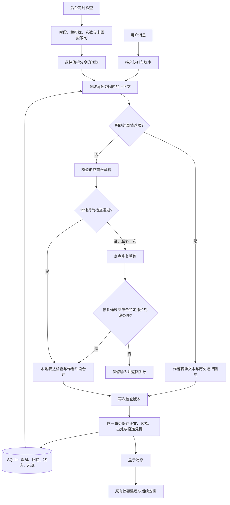

# 有间 0.9.2：可验证的交流连续性

## 职责边界

程序拥有事实、出处、场景进度、关系分支、用户明确偏好和投递记录；模型只提交回复草稿。模型说“已经记住”“我决定去旅行”不会修改任何权威状态。自然度是体验目标，不能证明每句文案都自然；下列数据与流程约束通过代码和对抗测试执行。

## 一轮交流

1. 持久队列合并输入并分配版本，新的输入撤销旧版本。
2. 本地交流策略识别明确要求（少分析、不建议、收尾、聊她的近况），计算追问数量等限制。
3. 从当前角色/当前剧本的证据回忆中检索至多3条相关原话；修正与删除优先，不允许跨域读取。
4. 生活线程、资讯资料差异、剧情后果分别提供当前已授权事实。过去的选择由程序重放，模型无法自选分支。
5. 调用模型形成草稿；本地检查和整理重复开场、追问数量及明确禁用的表达。没有可用正文时失败保留输入，不伪造成功回复。
6. 同一事务保存实际送达正文、策略执行记录与已验证的选择。仅此后更新证据回忆及投递凭据；旧版本不可提交。

## 新模块

- `episodic-memory`：真实消息ID、原话、说话者、范围、时间；确定性检索、用户校正、删除墓碑。摘要不是事实数据库，模型不能凭空写入条目。
- `conversation-policy`：本轮交流策略、明确相处偏好、本地输出约束和审计凭据。正常首稿只调用一次生成模型；0.9.2 的行为检查失败时至多追加一次定点修复，随后成功提交或明确失败。
- `life-threads`：作者设计的多日生活线及分支；时间到且上段已经分享后才推进一段，离线不突发补演，用户真实选择改变以后内容。
- `source-changes`：新旧来源原文片段比较，原文相同标为重复，差异标为“新增材料/待核实”，数字差异不擅自认定为现实变化。
- 剧情后果层：从已有选择记录计算关系互动方式、道具和已知条件，只开放满足条件的表现，不让模型补造共同经历。

## 必须通过的反例

- 模型尝试引用不存在或其他角色的消息，不能生成权威回忆。
- 用户删除/更正后，同一原消息重新整理也不能恢复旧条目。
- 用户说“不用建议”，草稿中的明确指令式建议不能直接送达；追问超额会被限制。
- 生活线程在重启、快速刷新、时间跳跃和重复投递时不重复推进。
- 同一剧情节点的不同既往选择必须产生可观察的不同反应；旧存档兼容。
- 两份报道只是转载或数字不一致时，不能由程序标为已证实的新进展。
- 用户在生成时改口，旧草稿不得提交状态或记忆。

## 成本与可查看性

检索、偏好识别、剧情与生活状态推进、来源差异比较不调用模型。页面能查看共同回忆、相处偏好、当前生活线与选择后果；保存执行记录解释规则是否实际生效。额外token主要是有上限的相关回忆与当前事实，仍保留固定前缀。

## 运行中的调用链

### 生活线程的时间与投递

三条初始目录在 `app-data/life-threads.json`：包装练习、日常拼贴、目的地旅行手册，各5段。每段的文本、感受、需要、成立事实和下一段间隔由作者配置；分支 variant 使用稳定 choice ID。扩充生活不需要新增模型工具，也不允许模型自写状态。

`get()` 只在首次创建线程，其后读取不推进。`tick()` 必须在当前段已经完整显示、12–24小时间隔到期后，最多推进一段。最后一段分享后进入48小时冷却；重新上线不追赶所有错过片段。旅行准备阶段不能创建声称已在目的地收集票据的手册；不同目的地期间暂停，旅行消失后可继续整理旧记录。

`markDelivered()` 要求真实的林雨薇 assistant 消息，且正文完整包含本段作者文本。普通聊天明确问她近况或后台选中线程时，作者文本直接进入消息，不分成可能被取消的后续片段。它和状态更新在同一 SQLite 事务内；只生成了草稿或被打断均不算分享。选择由固定按钮或精确短语识别，否定、问题和模糊表达不作选择；服务器核对选项、文字和版本，仓库再次核对签发计划与真实回复消息。

### 记忆更正与成本

共同经历只记录“当时真实说过这些话”，不证明角色叙述是真实世界事实。启动时一次性从各范围最近100条合格原消息补建证据，不读取退休人设的助手记录，不改原聊天。每个角色最多100条活动经历，容量满时只淘汰未固定条目；固定已满则跳过自动记录，不阻断聊天。

删除和更正会按原消息 ID 抑制所有重叠旧条目。用户更正保留原话用于核对，明确标为过时证据；最新更正优先。原始聊天仍可浏览，但被覆盖的原消息不再直接发给模型。已有滚动摘要无法逐句追溯出处，因此发生用户覆盖后，该范围不再把旧自由文本摘要用于对话；使用当前合格原文与证据经历。容量自动淘汰不触发这一摘要停用。手动长期记忆另由用户独立管理。

经历召回至多3条，合计上下文1500字符，并有重复使用冷却。林雨薇在用户明确问“记得吗、我以前说过什么、我住哪里”等问题时，另从未被删除或更正覆盖的用户原话中按需检索至多3条、合计700字符；它不常驻每轮上下文，也不新增模型调用。更正覆盖的旧消息ID会从这条检索路径排除，缺项要求回答“没找到”，不能补猜。新增证据放在本轮背景末尾，稳定人设、手动记忆、未被覆盖的摘要与近期实际聊天仍在前面。普通回复通常一次生成，行为修复路径最多再调用一次；明确剧情选项转场仍是零生成调用。命中量以服务商 usage 为准，不承诺固定费用降幅。

### 来源比较的范围

逐句比较的是已采集的摘要或已备读的正文片段，不能替代全文语义去重或事实核查。完全重复的可比较片段不作为新的追踪更新；不同片段与数字冲突都带 `verified:false`。实际发送时原子保存比较凭据，再移动该话题的基准，已聊过后仍可在页面查看和供追问使用。相似标题只用于候选关联，不能证明是同一事件。

### 可保证与不可保证

可检查的硬约束包括：消息出处与角色范围、删除和更正后的原话抑制、过期版本不提交、选项转场与已编写分支、真实投递才推进、明确结构性预算、主动次数和时段、修复调用上限。表达过滤是保守的模式与重复检测，不能证明所有自然语言都没有建议、暗示、退缩或事实错误；作者片段不受模型重写，但自由聊天的流畅度与真实性仍需要持续验收。遇到完全不符合规则的草稿会保留输入并提示重试，不连续付费重抽。只有用户明确要求撒娇、且草稿仅触发允许的表达形式问题时，程序可使用一条作者写定的安全短句；事实问答、记忆、资料、地点、天气和用户选择绝不使用这条兜底伪造答案。

页面入口：记得的事 → 共同经历/相处方式；生活足迹 → 当前生活线；一起看看 → 持续关注的话题/新旧材料；情境故事 → 选择回响。助手消息下可折叠查看“这次接话的依据”。
# 相处参数（0.9.1）

`CompanionTuningRepository` 在独立 SQLite 表保存十项整数参数和 revision。GET/POST `/api/companion-tuning`；POST `/api/companion-tuning/preview` 仅计算示例。字段校验与事务 CAS 防止多个页面互相覆盖；生成期间修改设置会取消旧草稿，已花费调用仍按实际用量统计。前端保留未保存编辑，409 提示重新读取，防抖与请求序号防止旧预览回写。

参数背景追加在动态上下文，固定人设和历史前缀保持。InnerState 使用敏感、乐观、活泼和暧昧值；ProactiveEngine 筛选允许联系的角色并按主动权重选择；ConversationPolicy 使用长度、安抚、亲昵限制及设置版本。没有新增情绪分析模型调用。代码保证取值、持久化、角色隔离、间隔、预算及版本一致性；语气的主观自然度仍需看实际生成，表达模式检查不是全语义保证。

# 紧凑上下文与行为编译（0.9.2）

林雨薇不再把 `roles.json` 中长篇重复说明逐轮送给模型。`compactCompanionSystem()` 生成当前957字符的固定中文系统前缀，保留成年苏州设计师、日常陪伴、事实边界、可回应亲近及不预设共同前史等核心规则；其他角色继续使用原提示。变化部分由 `compactCompanionBackground()` 白名单构造，只带当前时间、地点、活动、两项显著感受、真实互动次数与明确亲密边界。生活线程仅在用户问近况、相关项目、明确选择或主动生活线时加入；暂停线程不暴露未发送片段和选择，只保留已经分享的历史及已成立事实。

`model.mjs` 对林雨薇保留最近16条、合计6000字符的原始对话；明确保存的记忆另限12条、4000字符。动态结构化背景目标上限为1200字符，经历证据1500字符和按需原话检索700字符各自有界；更正证据和本轮行为计划作为需要完整保留的部分，不用粗暴尾截破坏最新更正或约束。这里的字符数是构造预算，不等同于服务商统计的token。

十项本地参数先由 `CompanionBehavior` 编译成本轮意图、语气、长度和至多一个 `extra` 表达槽位。模型以JSON分别提交主体和这个可选短表达，本地再检查问句、撤回亲近、虚构线下接触、小说式动作及表达缺失。实际送达后，行为类型、修复次数、引用消息ID等才与消息一起写入凭据；后续节奏读取最近真实投递凭据，因此未提交草稿不会消耗表达冷却。参数能确定阈值、候选与硬性次数，不能保证模型对每句自然语言都理解正确。

主动间隔按 `12 × (1 - initiative / 100)²` 小时计算到0.1小时；主动值为0时林雨薇不进入自动或手动主动候选。手动“立即联系”在主动值大于0时可以绕过这项个人间隔，仍受并发、状态版本、真实投递校验以及全局次数上限等约束。自动联系继续遵守安静时段、全局联系间隔、每日次数和未回应限制。公式给出的是可联系候选上限，不承诺一定发送，也不代表模型生成内容必然自然。

0.9.2 资料按当前话题进入：林雨薇仅在明确选文章、追问来源，或紧接带资料的上一条消息追问“你说的……”时恢复文章。额外生活资料要求当前消息命中主题提示或当地文化等明确指代，最多一篇；仅有生活背景不构成注入依据。明确亲近邀请、撒娇或距离要求暂不检索旧经历，仍保留近期原话、手动记忆及滚动摘要；显式回忆查询不走这条省略路径。检索和筛选不新增模型调用。

回忆答复若把答案与反问混在一起，先触发一次修复，防止后续限制问句时整句删掉实际答案。JSON格式、字符预算、表达槽位及投递间隔可检验；模式检查无法覆盖所有隐含问句、事实推断或不自然措辞。

# 消息重试与错误分类（0.9.3）

浏览器只对 `/api/chat/send` 的临时连接错误使用同一个请求体和clientId重试两次，服务端接收凭据保证即使回执丢失也不重复排队；不自动重试通用修改接口。接收后的生成由持久化 ChatQueue 负责：`retrying` 保存次数、错误代码与下一次时间，默认等待2秒/5秒，共至多两次自动重试。服务商 Retry-After 在120秒内时取更长等待，超过120秒直接保留消息并提示，避免提前再次请求。

ModelClient区分网络、超时、429、5xx、认证、余额及请求配置错误；429明确为额度不足时也不重试。临时异常可重试，取消、明确配置问题、过时选择和草稿行为检查失败不会触发队列重复生成。草稿检查本身仍至多修复一次；不会为了命中某个浪漫词汇反复调用模型，含蓄表达只受表达槽位与其他结构规则约束。正常成功不新增调用。

新消息替换旧重试版本并合并待回复原文，撤回清除定时器；刷新不改变服务端计数，服务重启保留尚未来到的截止时间和已用次数。正文保存与队列idle状态在同一SQLite事务提交，即使保存后后续逻辑抛错，也不会再次生成并重复保存。失败日志仅保留最近200项角色、版本、错误代码、上游状态、检查代码、重试次数及时间，不保存私聊正文、响应体或密钥。用量记录另外保留模型错误代码；模型返回成功、应用检查拒绝属于两种不同结果。
