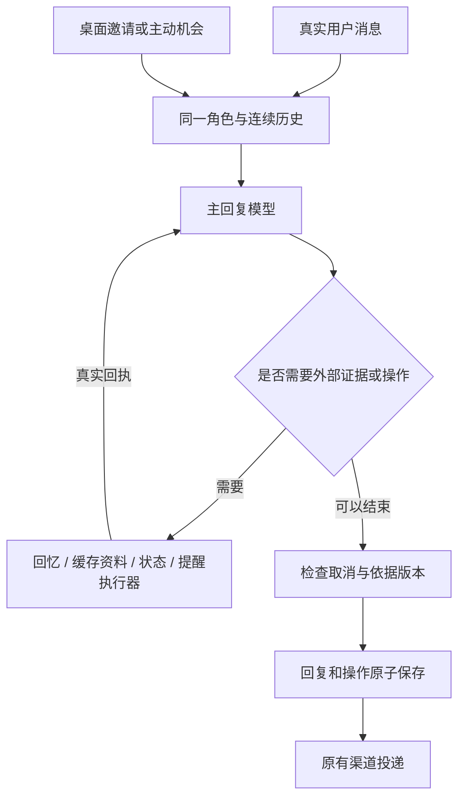

# 连续对话架构：2026-09-25 实施记录

## 目标与边界

让同一个人物根据真实连续历史，自然接话、主动联系、回应桌面邀请。近期原话足以解决的话题接续、纠正、换题、倾听与建议切换，交给同一个回复模型判断。程序负责历史可见性、真实时间、证据、操作执行、并发取消、存储与投递。

这里的 session 是应用维护的连续对话。每次请求重新提供经过可见性筛选的原生 user/assistant 消息，不依赖服务商保存某个永不失忆的 session。历史仍受用户设置的时间与预算窗口约束；窗口之外通过有出处的长期简记和按需回忆补充。

## 默认主路径

`start.mjs` 默认启用 `LIFE_SESSION_DIALOGUE`，前提是动态陪伴启用。普通文字（网页、桌面、微信）、桌面点击邀请与可选主动联系使用新上下文；显式剧情与旧生活选项保留兼容路径。



- 普通聊天不再先跑语义分类，不生成独立的对话计划，也不经过逐词措辞评分和文风重写。通常一次模型调用；需要工具时增加调用。
- 固定人物背景、用户表达偏好、关系事实、时间地点和必要来源回执作为背景；原话按时间顺序保留原生说话人。
- 角色自己的虚构日常允许合理细节并保持连续；用户经历、双方承诺、作品实际进度、公开资料和现实操作需要各自的证据。
- 模型可请求旧记忆、缓存资料、当前状态。缓存检索不代表实时联网搜索；状态读取返回可选关系/约定记录协议。
- 不要求每轮填情绪数值。旧动态面板记录保留，但新主路径不再将它当作每轮必须更新的对话任务。
- 桌面邀请保留 care/affection 手势。主动机会明确标为没有新用户发言，允许问候或表达惦记，也允许跳过。
- 主动联系仍遵守时段、间隔、安静设置、未回应限制、忙碌与发送前的历史复查；它不是用户承诺事项的执行器。

## 可靠性

- 旧记忆读取复用原有角色隔离、人物版本、历史修订与屏蔽规则。原始聊天不改写。
- 当前提醒含真实 ID 与时间；修改/取消调用执行器，不能只改回复文字。提醒操作先校验，再与最终回复一起提交；取消、生成失败或过期版本不留下半个操作。
- 检查当前生活版本、关系/约定、历史修订、记忆与用户偏好是否在生成期间变化；生活变化可重新生成一次，其他过期结果不发送。
- 从对话明确建立的提醒单独标记，按创建时的桌面/微信渠道到期投递，不占用可选主动聊天额度；安静模式延后它，恢复后补发一次。旧“留到以后聊”的提醒保持原有行为。
- 保留现有消息队列、补发合并、取消、重试和微信投递回执。模型生成成功与渠道送达仍是不同状态。
- 工具循环有步数上限；工具失败返回明确证据，不伪造成功。结构合法和实际存储可自动核对，正文是否准确理解用户仍需模型评估。

## 实际验证

使用当前配置的 `deepseek-v4-flash`。离线测试用假模型验证机制；真实模型测试使用隔离数据库，关闭微信、自动通知和后台任务。每轮模型实际输出进入下一轮历史，未将测试对话写入日常数据库。

第一轮完整对照覆盖九组轨迹：提议/接纳/观点/换题、持续纠正、倾听转建议、身份机制与回归角色、主动后接续、跨日旧记忆、计划与未知结果、桌面后接续、提醒创建/修改/取消。

实际发现并修复：

1. 新路径第一轮提醒测试创建成功，但修改只声称成功、取消缺少 ID。补入真实提醒状态与执行协议后，定向复测三项数据库变化全部成立。
2. 真实长历史回放中，来源追问缺少已有文章来源。补入可见历史消息的来源回执后，模型能准确说明来源是缓存摘录，未读全文。
3. 旧回归测试引用已删除角色，改为当前角色或显式隔离测试角色。
4. 同一生活事件 ID 内的阶段变化也需取消过时回复，已补完整版本检查。

完整对照中的旧路径在机制来源问题上被措辞/事实检查拦截；新路径能够回答并继续聊天。新路径也仍有未经确认的轻微假设，例如把分盆计划接成已经做完。没有据此新增逐词拦截，而是保留轨迹作为后续模型与提示词评估材料。

私密评估记录在 `.runtime/session-eval/` 和 `.runtime/session-migration/`，不纳入 Git。九组轨迹及定向复测不等于场景清单全部通过，也不保证任何模型不会口头误称操作成功。

## 本地发布状态

2026-09-25 已在 Mac 服务启用：健康接口报告 `sessionDialogue=true`、`semanticUnderstanding=false`；页面 HTTP 200，微信 connected，发送队列无待处理或失败项，聊天队列 idle。未发送真实微信测试消息。

最终相关测试 161/161 通过，`npm run check` 与 `git diff --check` 通过。发布前后的日常消息数均为 1473，提醒数均为 0；已有 36 项历史微信不确定回执保持原状。迁移没有导入测试聊天。

一致性数据库备份：`.runtime/session-migration/production-before.sqlite`。发布检查：`.runtime/session-migration/deployment.json`。详细真实模型复核：`.runtime/session-eval/session-full-0925/review.md`。

## 复现与回退

离线规划不读取服务商配置、不调用网络：

```sh
npm run evaluate:session
```

真实测试需显式开启并使用未使用过的标签：

```sh
node scripts/evaluate-session-dialogue.mjs --live --label my-session-review --variant both
```

运行有调用、请求体及 token 预算，并保留失败与原始输出；自然程度不以正则自动打分。

要切回旧对话路径，在 `.env.local` 设置 `LIFE_SESSION_DIALOGUE=0`，然后运行 `npm run service:install` 重启 Mac 服务。聊天、提醒和配置继续保留。移除此覆盖并重启即可回到新路径。迁移前源文件备份保存在 `.runtime/session-migration/before/`；数据库另做 SQLite 一致性备份。服务器端保持此前停止状态。
