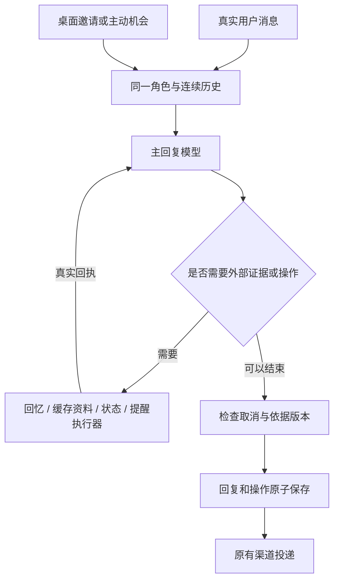

# 连续对话架构：2026-09-25 实施记录

## 目标与边界

让同一个人物根据真实连续历史，自然接话、主动联系、回应桌面邀请。近期原话足以解决的话题接续、纠正、换题、倾听与建议切换，交给同一个回复模型判断。程序负责历史可见性、真实时间、证据、操作执行、并发取消、存储与投递。

这里的 session 是应用维护的连续对话。每次请求重新提供经过可见性筛选、带原始说话人和发送时间的原话记录，不依赖服务商保存某个永不失忆的 session。正式入口现在使用北京时间当日00:00起的原文和按日核心，仍受历史预算约束；完整旧原话通过按需回忆补充。每天默认02:00整理今天以前的内容；02:00后用户聊天、桌面交互或主动联系若尚未整理完，会先等待通过提取与核对，再准备对话上下文。整理失败保留排队输入，不先生成缺少昨日证据的回复。

## 默认主路径

`start.mjs` 默认启用 `LIFE_SESSION_DIALOGUE`，前提是动态陪伴启用。普通文字（网页、桌面、微信）、桌面点击邀请与可选主动联系使用新上下文；显式剧情与旧生活选项保留兼容路径。



- 普通聊天不再先跑语义分类，不生成独立的对话计划，也不经过逐词措辞评分和文风重写。默认使用同一模型生成本轮提示、正文和检查（通常三次调用）；有实质问题时最多改写一次，改写后再核对一次，需要工具时增加调用。提示或首次检查不可用时沿用格式有效的正文；已识别有依据的偏差后，修正或复核未通过则保留排队输入并按既有预算重试，不发送已知错误草稿。逐次耗时与服务商用量可在诊断页查看。
- 固定人物背景、用户表达偏好、关系事实、时间地点和必要来源回执作为背景；较早原话以明确标注作者和时间的 JSON 证据块提供。按日整理模式用本轮短编号和统一作者映射减少重复元数据；最近16条恢复为按实际顺序排列的原生 user/assistant 消息，系统目录与其一一对应。本轮实际用户输入最后追加，不制造事件型 user。检查模型收到双方原话的明确引用，避免把角色历史发言当成检查者自己的回答。核对建议区分原始证据引用与草稿错误定位；草稿中的新增断言不能被提升成事实依据。时间与工具回执属于系统元数据。
- 角色自己的虚构日常允许合理细节并保持连续；用户经历、双方承诺、作品实际进度、公开资料和现实操作需要各自的证据。
- 模型可请求旧记忆、缓存资料、当前状态。缓存检索不代表实时联网搜索；状态读取返回可选关系/约定记录协议。
- 不要求每轮填情绪数值。感受、需求和未完话题接入主路径，也可以通过 state 按需读取；dynamics 仍是可选字段。角色感受只接受本轮实际送达的角色表达作为来源，用户愿望不能冒领为角色感受。
- 桌面邀请保留 care/affection 手势。主动机会明确标为没有新用户发言，允许问候或表达惦记，也允许跳过。
- 主动联系仍遵守时段、间隔、安静设置、未回应限制、忙碌与发送前的历史复查；它不是用户承诺事项的执行器。

## 可靠性

- 旧记忆读取复用原有角色隔离、人物版本、历史修订与屏蔽规则。原始聊天不改写。
- 当前提醒含真实 ID 与时间；修改/取消调用执行器，不能只改回复文字。提醒操作先校验，再与最终回复一起提交；取消、生成失败或过期版本不留下半个操作。
- 检查当前生活版本、关系/约定、历史修订、记忆、角色感受、成长反思与用户偏好是否在生成期间变化；生活变化可重新生成一次，其他过期结果不发送。
- 从对话明确建立的提醒单独标记，按创建时的桌面/微信渠道到期投递，不占用可选主动聊天额度；安静模式延后它，恢复后补发一次。旧“留到以后聊”的提醒保持原有行为。
- 保留现有消息队列、补发合并、取消、重试和微信投递回执。模型生成成功与渠道送达仍是不同状态。
- 工具循环有步数上限；工具失败返回明确证据，不伪造成功。结构合法和实际存储可自动核对，正文是否准确理解用户仍需模型评估。

## 实际验证

使用当前配置的 `deepseek-v4-flash`。离线测试用假模型验证机制；真实模型测试使用隔离数据库，关闭微信、自动通知和后台任务。每轮模型实际输出进入下一轮历史，未将测试对话写入日常数据库。

第一轮完整对照覆盖九组轨迹：提议/接纳/观点/换题、持续纠正、倾听转建议、身份机制与回归角色、主动后接续、跨日旧记忆、计划与未知结果、桌面后接续、提醒创建/修改/取消。

实际发现并修复：

1. 新路径第一轮提醒测试创建成功，但修改只声称成功、取消缺少 ID。补入真实提醒状态与执行协议后，定向复测三项数据库变化全部成立。
2. 真实长历史回放中，来源追问缺少已有文章来源。补入可见历史消息的来源回执后，模型能准确说明来源是缓存摘录，未读全文。
3. 旧回归测试引用已删除角色，改为当前角色或显式隔离测试角色。
4. 同一生活事件 ID 内的阶段变化也需取消过时回复，已补完整版本检查。

完整对照中的旧路径在机制来源问题上被措辞/事实检查拦截；新路径能够回答并继续聊天。新路径也仍有未经确认的轻微假设，例如把分盆计划接成已经做完。没有据此新增逐词拦截，而是保留轨迹作为后续模型与提示词评估材料。

私密评估记录在 `.runtime/session-eval/` 和 `.runtime/session-migration/`，不纳入 Git。九组轨迹及定向复测不等于场景清单全部通过，也不保证任何模型不会口头误称操作成功。

## 本地发布状态

2026-09-25 已在 Mac 服务启用：健康接口报告 `sessionDialogue=true`、`semanticUnderstanding=false`；页面 HTTP 200，微信 connected，发送队列无待处理或失败项，聊天队列 idle。未发送真实微信测试消息。

最终相关测试 161/161 通过，`npm run check` 与 `git diff --check` 通过。发布前后的日常消息数均为 1473，提醒数均为 0；已有 36 项历史微信不确定回执保持原状。迁移没有导入测试聊天。

一致性数据库备份：`.runtime/session-migration/production-before.sqlite`。发布检查：`.runtime/session-migration/deployment.json`。详细真实模型复核：`.runtime/session-eval/session-full-0925/review.md`。

## 复现与回退

离线规划不读取服务商配置、不调用网络：

```sh
npm run evaluate:session
```

真实测试需显式开启并使用未使用过的标签：

```sh
node scripts/evaluate-session-dialogue.mjs --live --label my-session-review --variant both
```

运行有调用、请求体及 token 预算，并保留失败与原始输出；自然程度不以正则自动打分。

要切回旧对话路径，在 `.env.local` 设置 `LIFE_SESSION_DIALOGUE=0`，然后运行 `npm run service:install` 重启 Mac 服务。聊天、提醒和配置继续保留。移除此覆盖并重启即可回到新路径。迁移前源文件备份保存在 `.runtime/session-migration/before/`；数据库另做 SQLite 一致性备份。服务器端保持此前停止状态。


## 2026-09-25 晚间连续性修复

实际故障：角色先主动分享白矮星，用户接着谈星体，回复却说成“你上一条说的那颗白矮星”，并再次追问早已过去的吃饭、坐躺问题。生成与微信队列正常，错误发生在内容理解。

修复：

- `withDialogueTime` 不再伪造 user 消息。历史相对日期以历史发送时间为准，当前时间只解释本轮表达；时间经过不等于计划完成。
- 窗口内历史原文、顺序、日期和说话人全部保留，以明确标注来源的历史记录提供，避免把旧助手的反复追问继续当作示范。原始数据库不改写、不删旧回复。
- 生活状态放入 `facts.character`，明确角色 ID、姓名、地点与活动；之前无主语的 location/activity 容易被当成用户状态。提醒、来源回执仍单独保留。
- 桌面点击有明确的事件含义，不隐含新的用户发言或任务结果。工具回执使用 system，普通聊天仅保留一条本轮真实 user。
- 诊断统计识别历史证据块；评估加入长历史中助手主动提出话题后的归属和后续问题。

真实评估记录：`.runtime/continuity-fix/`、`.runtime/session-eval/continuity-final-0925/`。测试均使用隔离副本，不发送真实微信消息。原始请求、调整后历史、不同思考强度都做了对比；思考模式存在空 JSON 回复和理解不稳定，未改变线上模型配置。

最终十组轨迹共 28 次模型调用，提醒创建/修改/取消三项数据库状态变化成立；长历史星体测试认领话题正确，没有复发吃饭、坐躺追问。实际长历史副本另外连续回放四轮，也未复发该归属错误。

限制：十组运行完成不代表十组自然对话全部合格。仍观察到日期措辞错误、桌面回复擅自推测尚在收文件、个别无关追问及天文常识不准确；真实长历史中仍会编造不合时刻的环境细节。这些没有被逐词拦截器掩盖。主动案例当轮选择不发送，因此后续“接受刚才主动话题”并未有效覆盖；评估器增加前置投递依赖，防止以后把未发生的开场当成已发生。

相关离线回归 132 项通过，语法与补丁空白检查通过。全量历史测试另有失败及悬挂，包含已删除角色的旧用例，不能据此声明全仓库测试通过；本轮修正了 architecture-v09 隔离测试的角色配置以解除其等待。完整诊断日志在 `.runtime/continuity-fix/full-tests.log`。


补充定向复测 `.runtime/session-eval/continuity-skip-0925/`：主动开场实际发出，后续按模型真实开场继续，两次调用均成功且话题归属正确；主动开场仍把分盆计划问成已经挪好，作为未知进度方面的剩余问题保留。

本次修复已重启 Mac 本地服务，PID 96428。页面 HTTP 200，健康接口正常，微信 connected，聊天队列 idle，微信待发/失败均为 0；已有 36 条历史不确定回执未变。发布前后均为 1475 条日常消息、0 条提醒。备份 `.runtime/continuity-fix/production-before.sqlite`，发布检查 `.runtime/continuity-fix/deployment-before.json` 与 `deployment-after.json`。服务商模型配置未改，服务器端未启动，本轮未创建 Git 提交。


## 2026-09-30：历史归属与成长升级

- `session-history.mjs` 统一作者归属；近期原生历史与较早档案互不重复，历史用户引用角色的话不改变原作者。
- recall 搜索所有符合人物版本、时间、可见性与更正规则的历史，不再限于最后 2000 条。默认主路径可由同一模型展开检索同义词；它生成的是查询，不是记忆。返回原文保留标点和换行。
- 配置 `LIFE_EMBEDDING_MODEL` 后可启用真实向量检索，缓存按角色、模型、原文哈希隔离。召回每次最多补 64 条，诊断页每次“更新语义索引”补 128 条；未建完的语义索引不能保证覆盖全部同义表达，原文检索仍覆盖全部可见历史。语义服务失败降级为原文检索。
- 角色反思在至少 12 条新原话、且距上次至少 6 小时后，趁对话空闲整理；主动消息也可形成原话来源。每批取最新未处理的至多 40 条（首次从最近历史启动）、16000 字符片段、一次 1800 输出 token 调用。日记必须有角色原话来源；兴趣、看法、表达习惯只接受角色证据。成长范围分 enduring（持续倾向）和 session（临时状态）；enduring 在至少两个不同上海自然日、作为不同新用户消息的直接回复得到支持后才成为 stable。同日重复、主动自述、桌面邀请不升级稳定程度。固定身份与关系边界另由既有系统管理。
- 修改、屏蔽、人物版本切换和删除会使相应派生记录失效。删除同时清除关联日记、成长条目和向量缓存，反思生成与索引写入会重新核对源消息。
- `/dialogue-diagnostics.html` 展示消息作者、结构化记忆、感受、日记，以及普通/桌面/主动轮次的提示、检查修订、工具回执、状态版本、耗时和用量。
- 完整 JSON 导出保留数据库结构与记录；凭据、微信收发队列与未投递的临时任务不导出。JSON 仅包含图片索引；SQLite 分支另行复制图片文件。SQLite 分支另外私密保存模型配置，所有相处状态独立复制。分支标记强制关闭自动任务、微信、到期提醒派送并绑定 localhost；不能经微信接口开启外部发送。
- 朗读按句分段，第一段最多 100 字符、后续 180 字符，同时准备两段；结束一段后释放其 TTS 任务。停止、页面离开、过期、服务关闭及原消息更正/删除都会取消任务。当前 TTS 提供分段完整音频，不提供逐 token 的语音流。

运行归属专项：`node scripts/evaluate-companion-upgrade.mjs` 为零网络预览；加 `--live --label 唯一英文标签` 使用实际配置模型，在隔离数据库回放，保存 `.runtime/companion-upgrade/标签/report.json`。上限为 100 次调用、100 万已报告 token，禁止外部通知与发送。首次实测 8 场景、13 轮、44 次调用、105954 token，逐条核对最终回复后归属正确；检查层修订了无出处的动机、用户品味解释与旧事修饰。这是固定轨迹的验证，不代表所有自由对话都不会出错。

补充实测：本地 TTS 两段音频均成功，首段约 10 秒就绪，总生成约 12 秒，停止清理全部任务。成长实测保存了有原文出处的日记与兴趣，并连续两轮正确区分角色的灰蓝/留白偏好和用户的墨绿/较密偏好。作者字段最终由消息 ID 查询原作者，可规范化明确的中文姓名标签，但拒绝与原作者冲突的标签。

2026-10-01补充：运行 `node scripts/evaluate-companion-upgrade.mjs --daily` 预览晨间压缩后的10类场景；添加 `--live --label 唯一标签` 使用配置模型回放16轮。`--only old-recall,accepted-sharing,latest-intent` 可复测指定场景。首轮模拟次日08:00，先提取和核对昨天原文，再验证提议与观点归属、纠正、按需原文召回、未执行计划、已接受分享及最新意愿。发现回指被扩写成未提供的图像细节后，加入对象核对与明确假设例子规则；检查修改后的草稿才允许保存。固定回放验证不能保证自由对话完全不出错。

## 2026-10-01：行动阶段、当前意图和临时成长

前置提示同一次调用返回当前 focus 和少量原子 claims。每条注明原话 ID、作者及 proposal/acceptance/reported/uncertain 阶段；程序校验作者和原文子串，用户 claim 不能引用角色消息。focus 只能引用本轮实际用户原话。阶段与语义仍由模型解释；正文和独立检查继续读取完整原始证据，不将生成的提示当成已确认事实。

按日核心的请求投影同时提供程序从原消息读取的上海发送时刻；多来源条目给出首末时刻。发送时间与 text 中计划发生的时间分别理解，避免“早上提议今晚散步”被说成晚上才提出。不修改已审核核心与原消息，不重新调用模型回填；时刻随核心一起受上下文字符预算约束。

正文与检查明确区分邀请、接受、动作发生和结果，含糊词不推出骑行或通勤。亲近姿态可以与书、电视和具体观点并行，未拒绝旧话题不表示需要继续反复说它。按整段意思识别把用户送走的收尾。角色普通虚构生活允许新细节；共同想象场景与角色当前生活日程分别理解，不因两层场景不同机械拒绝正常描写，也不代用户推进动作或修改已确认轨迹。

独立检查仍保留思考调用。只有检查耗尽输出预算或超时，才用相同原始证据与相同草稿额外重试一次短检查；重试8秒、1700输出token，不沿用未完成的思考文本。已识别偏差后，修正稿必须通过核对才保存。取消立即传播，不触发补救调用。诊断记录额外调用目的和失败原因。

旧成长先由配置模型复核 scope，可通过 `POST /api/character-growth/reassess` 执行；缺少范围的旧条目暂不注入正文。只有有跨日独立支持的长期倾向进入成长提示，至多8条、1600字符的条目预算；日记和证据引文继续保存在诊断数据中。当日想法仍由当日原文、较早想法由按日核心和原文召回接续，不依靠成长提示重复强化。

评估脚本新增 `--interaction` 六组当前问题回放和 `--growth` 三组成长范围回放，可组合 `--daily --only 场景ID --live --label 唯一标签`。当前实际模型为 `deepseek-v4-flash`。本轮隔离测试覆盖六组九次交互、原有十组十六次历史回归、三组成长整理及正式数据副本两次普通日常交流。长历史实测检出了“整天没出门”等矛盾轨迹，并在修正核对通过后才保存。另用真实模型刻意限制第一次检查输出预算，验证短检查能够找出未经确认的订票与出行断言。成长提示在正式副本从约4600字符降到232字符，这是一个背景块的变化，不是总请求token减少95%。

私密记录位于 `.runtime/companion-upgrade/interaction-final-1001/`、`dialogue-regression-1001/`、`growth-verified-1001/` 和 `.runtime/dialogue-analysis/2026-10-01/`。测试对话只保存在隔离数据库；当前发现的无关追问和部分日期措辞偏差仍是进一步优化点，不据固定测试承诺自由对话永远正确。

## 2026-10-06：普通生活与按需公开信息

林晓薇的职业保留为自由平面设计师，日常时间安排加入饭菜选择、影视、音乐、散步、休闲阅读及旅行想法。工作日下午有休息时段，晚上可以挑剧或电影；周末及已登记的2026年中国节假日采用休息日安排。旧版日程更新时保留已经过去和正在进行的活动，只重新生成剩余时段，避免把已经讲过的地点和经历改掉。其他年份暂按普通周末判断，不能宣称掌握尚未登记的调休安排。

公开素材目录配置在 `app-data/daily-information-sources.json`，目前12个来源覆盖吃饭、剧集、电影、旅行、新闻、产品、游戏、阅读、音乐九类。正式应用运行后独立检查采集时间，新闻约2小时、科技约3小时、其他来源6至12小时更新；下次时间及失败退避保存在SQLite，重启后继续。采集只抓公开RSS、新闻榜和页面标题链接，不调用模型、不生成聊天。单个来源不可用不阻塞其他来源；无登录或验证码绕过。

`daily_information_items`只保存标题、类别、来源链接、至多160字的导语、发布/观察时刻，按规范化链接和同类标题去重，最多2500条。新闻候选窗口14天、产品90天，其他类别180天；未给出发布日期的条目只表示观察到该标题，不等于当天发布。常规对话只提供至多4000字符的小组线索，饭点优先食物，休闲时优先影视/音乐/阅读等，仍由模型按当前交流决定，不轮番强塞主题。

原有前置理解调用可以返回一个受限的 `informationCategory`，程序再读取该类别至多6000字符的标题目录，不新增模型调用，也不由代码关键词决定用户意图。该判断只是建议，当前用户原话仍优先。普通聊天和主动联系都可使用 `explore`：类别或关键词只读本地标题，选定ID才读取公开正文摘录；普通聊天最多3次工具读取、主动分享最多2次。标题不足时可按预设公共类别补充检索，使用已有搜索服务的配置、每日额度和冷却，不发送原始私密对话。无可用搜索服务或正文不可读取时返回未知范围，不假装已查到；也允许明确按已有知识聊经典影视和一般观点。

正文摘录最多2200字符，新闻/产品缓存6小时，其他类别3天。发布者更正同一链接时更新提示并清除详情缓存，但不改写已经发送的聊天和来源快照。只有最终回复实际采用素材才保存分享记录和来源卡；读取本身不算分享，近7天已采用的条目不进入常规候选。用户追问仍可继续读取，删除或屏蔽对应聊天会清除/排除分享证据。公开报道、作品细节和现实操作须按来源范围表达，角色正常虚构生活允许合理细节并维持连续性。

实测发现并修正了来源记录遇到多段正文无法匹配、模型裸ID无法登记、主动分享附加普通聊天字段导致拒绝、以及辅助记录对代码围栏/换行JSON的解析与正文不一致等问题。新产品询问曾被否定约束中的“价格”带偏成定价新闻，后改为模型先按正面请求选类别，再展开该目录。日常信息需要时适当扩大审稿的时间与输出预算，仍保留原话核对和已识别偏差后的修正检查。

诊断入口为 `GET /api/daily-information`，人工刷新为 `POST /api/daily-information/refresh`。可运行 `node scripts/evaluate-daily-information.mjs`查看零网络预览；`--live --label 唯一标签`使用当前模型在隔离数据库测试，也可用 `--only news,products,series,open-sharing`回归指定情境。正式历史副本和模型评估保存在 `.runtime/daily-information/`，测试不向正式聊天或微信发送。

最终全量自动测试1639/1639通过，语法检查和差异空白检查通过。真实配置模型的八情境基线、一轮四情境选题回归及正式历史副本三次普通交流完成；主动信息分享也完成。新产品回归选中了实际发布的SANWA鼠标并读取正文，标题层音乐分享明确尚未试听；正式副本分别扩展食物、电影和音乐目录。影视新剧目录有行业消息较多的局限，无可用新搜索结果时只能明确按已有知识聊经典作品。该有限样本不能保证自由对话始终没有偏差。

正式服务已重载，首次自动采集332条、九类信息、12个来源均成功，详情缓存仍为0，定时检查已启动。发布前后均为2131条正式消息，逐条原文摘要校验无变化，SQLite完整性正常、聊天队列idle、晨间整理待处理0。数据库备份和复核记录见 `.runtime/daily-information/2026-10-06/deployment/`；汇总报告为同目录上级的 `verification.json`。采集需要本地服务运行及网络可用，源站中断会按保存的时间退避再尝试。

## 2026-10-07：场景与进度突然跳变

本轮确认的范围是场景、物件与步骤的连续性。实际主动消息包含当日此前61条历史，但本轮提示把“在外面吃午饭”的自动日程当成必须遵从的现场状态，覆盖了尚未结束的共同场景；检查层修正了人物归属，却放过地点跳转。原有记录里还存在已打印、晾好的同一张色带又变成刚打印的进度倒退。

沿用现有提示生成、正文与独立检查三阶段，同一份场景接续规则用于三处，不新增分类器或记忆数据库。`facts.character.activityScope` 明确日程的当前安排不等于离开、抵达、动作完成或共同场景结束的回执。提示生成优先在已有的、核对作者与原话的 claims 中保留一至两条影响本轮位置或进度的记录。已确认的角色自述也须延续，同一物件不倒退；换话题、时间经过或没有新消息不自行替双方散场。前文明确收尾、暂别或选择转场后，角色可以进入下一段生活，普通生活推进应接住已有步骤并交代相关过渡。

独立检查把未经交代的场景切换与已完成步骤倒退视为实质问题，不能以“角色生活可以虚构”豁免，也不能用补造双方已经结束或用户离开的经过来圆场。主动接续评估同时区分仍在进行的共同场景和将来的约定。新增集成回归覆盖普通回复与没有素材候选的主动消息，核对错误草稿在保存前被修正、原草稿未入库。

使用当前 `deepseek-v4-flash` 的普通共同吃面场景，旧链路在没有转场原话时实际生成“我在外面吃着午饭”，复现了问题。修改后六组八轮回放覆盖已晾好色带、共同用餐、完成步骤、明确离开、只换话题及角色已完成的工作；补充四轮检查了已描述图案的完成状态，以及两份故意写错地点和进度的草稿。十二轮均完成，逐条阅读确认目标进度没有倒退、共同场景没有被日程覆盖；两份错误草稿均被独立检查修正。原始缺少图案描述的拼图案例曾要求补充图案内容，这属于图像证据范围，不能据此声称全部自然交流已验收。

全量自动测试1641/1641通过，语法和差异空白检查通过。正式服务已重载，发布前后2238条原始消息逐条校验无改写或删除，SQLite完整性正常，聊天队列空闲、晨间整理待处理0。私密回放、修改前源文件、数据库备份和发布检查保存在 `.runtime/scene-continuity/2026-10-07/`，汇总为 `verification.json`。测试只使用独立的普通场景，不向正式聊天或微信发送；有限回放不保证自由对话永不出现模型判断偏差。

## 2026-10-13：更像真人的说话方式、可靠的调参与缓存结构

问题（基于 9-28 至 10-12 的真实记录）：你的消息中位 17 字，她的回复中位 185 字；你只发不到 8 字时她仍回 126 字；338 条回复里只有 1 条短于 40 字；91% 含“——”，42% 含“我这边”，37% 引用你的原话再点评。独立审稿改写了 27% 的回复，其中不少删掉的正是真人会说的猜测和玩笑。每轮注入约 60 条“边界”整理记录，是“立规矩”口吻的主要来源。缓存命中约 18%。

改动：
- `lib/companion-voice.mjs`：十项相处参数按低/中/高三档转成具体行为描述，每档配 3 句话题无关的口气示例，按日期轮换（同一天内不变，不影响缓存）。话量另外决定每轮字数预算，超过硬上限时同一会话让模型缩短一次；照搬当天示例原句时也会重写一次（`tightenSessionReply`）。
- 人设加入【说话方式】：一行一条气泡、长短跟随用户、口语、不复述用户原话、不每条汇报近况、可以猜测和说错、少叮嘱、不替用户决定回不回。存储仍是一条消息；网页按行显示为多个气泡，微信按行拆成多条、间隔 1–2.5 秒严格按序发送。
- 审稿：准备阶段判为 fast 且没有工具、资料或关系记录的轮次直接发送；审稿明确放行猜测语气、让对方回来说一声、角色自身生活细节和口语不精确。
- 记忆注入：按日核心改为“近三天 + 最近 5 条仍有效边界 + 仍有效约定/偏好/纠正”的稳定部分（放在前缀里），以及“与本轮词语相关的较早记录”的查询部分（去掉今天/下午等通用词）。
- 提示顺序：人设 → 长期背景 → 对话规则 → 历史（原生消息窗口每 8 条整体移动一次）→ 本轮证据 → 本轮轮次 → 用户。准备、正文、审稿三个调用共用同一段前缀；本轮末尾保留一行 JSON 格式说明（DeepSeek JSON 模式在格式说明远离末尾时会返回空白）。
- `lib/model.mjs`：DeepSeek JSON 模式返回空白时，先原样重发一次，再改为非 JSON 模式加格式提醒重发一次。
- 去掉【近期表达参照】（会让模型模仿自己以前的长段落），去掉动态数据里按分钟变化的 ageMinutes。

实测（隔离副本，同一快照，同一组 14 轮日常对话，deepseek-v4-flash）：旧版每轮 3.14 次调用、输入 56.3 万 token、缓存命中 16%、中位耗时 7.4 秒、回复中位 122 字；新版每轮约 2.1 次调用、输入约 32–35 万 token、命中 62–71%、中位耗时约 4.6 秒、回复中位约 20–50 字（随话量）。话量 15/85 的回复中位约 15–19 / 35–61 字；“冷淡/活泼”两组口气差别明显；示例照搬 0 次，开头几乎不重复。

复测：`node scripts/evaluate-naturalness.mjs --label 标签 --live [--tuning '{"verbosity":20}'] [--template 目录]`；`--dry` 为零费用的前缀复用分析。报告含长度、气泡数、缓存、调用次数和“套路化”统计（照搬示例、开头多样性、跨轮重复短语）。改动前的源文件在 `.runtime/naturalness/before-src/`。

2026-10-13 下午调整：按使用反馈改回“一次回复 = 一条消息”。人设要求一条消息说完、不逐句换行；不超过 120 字的回复若仍有换行，程序合并成一行（无标点处加空格）；网页单气泡显示，微信合并为一条发送。微信发件保留严格按序投递。


## 2026-10-13 晚间：复盘真实记录后的修正

依据 10-12 至 10-13 的 141 轮 trace 和原文复盘（每轮 2.2 次调用、中位 23k prompt token、中位 9.4 秒、回复中位 39 字），发现的问题与处理：

- **准备器自己制造了套路。** 它几乎每轮把已确认的分寸、叫停信号写成“延续……”的 claim 要求正文保留，正文于是每轮复述一遍；它还直接写语气、句数（“可以有一两句撒娇”），等于替正文定稿。现在 `PREPARATION_INSTRUCTION` 只允许事实层面的提示（谁说的、到哪一步、什么未知、哪条纠正仍有效），单条不超过 80 字（程序上限 200），已说定的事写成“仍有效、不得违反”而不是要求复述；`applySessionGuidance` 注明提示里的约定是不得违反的事实、不是要说出来的内容，语气长短只按【说话方式】与【本轮篇幅】。
- **共同想象场景里出戏。** “就顺着演吧”“你在韩国那扇门我又推不开”“等你人到跟前再算”来自“切换时自然交代”这条规则。现在【接续与归属】和【说话方式】都写明：在共同场景里就待在场景里说话，不解释想象与现实的分层，除非用户直接问是不是真的。
- **被怼就认错。** 新增：被否定时不用马上认错或自贬，觉得没错就坚持，或不服、闷一下。
- **“我这边”只禁了开头**，全挪到句中（14/140）。改为“少说‘我这边’，说‘我’就行”；同一表情、同一口头禅不连着几条都用。
- **把话送走的句子集中在主动消息**（2/8）。`tightenSessionReply` 对主动消息检查 `pushesAway`（不打扰你/你先忙/等你有空再聊……），命中让同一会话改一次；普通回复不查，因为用户可能刚说再见。
- **跨轮复读**（“谁先动谁是小狗”连用、😏 两小时三次）。`repeatsRecent` 用最近 4 条回复做 6 字连续片段和表情比对（用户原话里出现的片段不算），命中改一次，改后仍复读则保留原稿（`STILL_REPEATING`）。原始历史不改写。
- **`independence` 高档文案**“忙的时候会说晚点聊”与禁令打架，改为“不围着他转，忙着也会接一句，不把他往外推”。
- **DETAIL 预算误触发**：“为啥会湿啊”“那你会怎样呀”这类 5–6 字的调侃句命中“为啥/怎样”进入 140 字预算。现在用户消息至少 10 字才算详细请求。
- **相处参数的三档与 UI 不一致**：除话量外每项按 0–33/34–66/67–100 三档生效，同档内数值无差别（当前 6 项打到 100 等同于 70）。`tuningPreview` 的阈值改为和 `companion-voice` 同一套三档，说明里直接写出当前各项所在档；暧昧/主动的字段说明改成 session 路径的实际作用（旧的“主动亲昵间隔 N 小时”属于旧路径）；独立性与撒娇/暧昧同时高档时提示会互相拉扯。
- **延迟**：准备调用中位 4 秒，而 77% 的轮次判为 fast。`start.mjs` 默认启用 `LIFE_SPECULATIVE_DRAFT`：准备与正文同时从同一缓存前缀发起；准备判为 fast 且没有扩展目录、草稿没有提醒操作时直接采用并行草稿（trace `speculativeDraft=used`），否则作废并按原流程带提示重写（`discarded`/`action`/`failed`）。并行草稿可以读证据，遇到提醒请求立即中止、不暂存任何操作；轮次结束或上下文过期时一并中止。测试环境默认不开（脚本化假模型按顺序应答），`LIFE_SPECULATIVE_DRAFT=0` 可关闭。预计中位耗时从约 9 秒降到 5 秒上下，reasoning 轮多花一次已缓存的正文调用。
- 来源回执从最近 4 条、每条 1200 字符减为 3 条、500 字符，仍可用 sources 读更多。`dialogue_traces` 现在保存 `length`（篇幅/复读/推开检查结果）和 `speculativeDraft`。
- 提醒：`app-data/roles.json` 里 miyue 的 `systemPrompt` 字段在 session 路径不读取（`personaFor` 只用 `profile`），改它不会影响当前对话。

验证：相关测试与全量测试通过（`test/followups.test.mjs` 的 3 项依赖进程时区，机器不在 Asia/Shanghai 时需 `TZ=Asia/Shanghai` 运行，与本次无关）；新增 `test/companion-voice.test.mjs`、`test/session-speculative-draft.test.mjs`。零费用前缀复用分析 0.62，与改动前持平。本次没有做真实模型回放（修改所在会话无法访问模型接口），请用 `运行自然度测试.command` 或 `node scripts/evaluate-naturalness.mjs --label 标签 --live` 复测，重点看 trace 里 `speculativeDraft` 的比例、`length.reason` 的触发次数，以及亲密场景里是否还每轮重申分寸。
