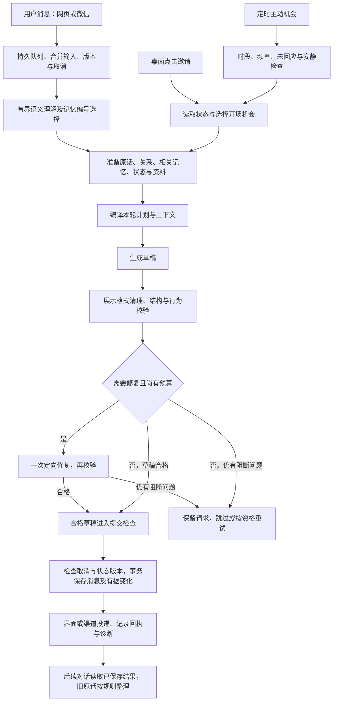

# 有间：对话逻辑与预期体验总览

历史窗口更新于 2026-09-20，其余评估截至 2026-09-16。本文件汇总截至本次讨论已确认的产品方向，并对照当前源码、阶段实施文档与实测记录整理。它是理解整个项目对话系统的入口；各专题文档保留实现细节和当时的验证证据。旧文档中的版本、窗口、调用次数、启用状态不能直接当作当前行为。

本文以唯一角色林晓薇的日常陪伴为主，说明网页、桌面、微信、语音的职责。标为“预期”的内容是验收目标；“已接入”表示有运行路径，不表示模型在所有自然语言中都能可靠做到。最新一次实现补充了有来源的讨论主题及兴趣反馈，具体状态与验证见 [讨论主题与兴趣反馈](DISCUSSION-TOPICS.md)。

2026-09-25 实施更新：Mac 默认入口采用[连续对话架构](DIALOGUE-SESSION.md)。下文涉及前置语义分类、独立回合计划和措辞修复的流程描述，适用于保留的旧兼容路径；新默认路径、实测缺口和回退方式以该实施记录为准。

2026-09-25：后续架构讨论先以[对话场景清单](DIALOGUE-SCENARIOS.md)检查入口、接续、关系、主动、约定、共同活动与异常恢复的覆盖面。该清单是产品与验收草案，包含组合场景及待讨论的体验取舍，不表示新增能力已实现或已通过测试。

## 2026-09-20 当前运行路径

日常与主动联系已接入模型主导的情绪、需要与进度状态，以及自然语言表达偏好和有来源的活动发现。新路径跳过后文旧版本描述的固定话术、附加句及按风格重写机制；来源、时间、用户事实与并发校验继续保留。历史修订作为可恢复的读取投影使用。实现、实际模型失败案例、验证用量及剩余问题以 [人物对话演进](COMPANION-EVOLUTION.md) 为准。

2026-09-23 补充：普通聊天在开放邀请、无待回答问题的简短承接，以及能自然联想的用户分享中，可以提供一个可选的资讯、进行中生活、持续阅读兴趣或讨论切口。回复仍先接用户当前的话；安慰、明确问题、纠正、事实核对、亲近、边界、正在兑现的提议和当前讨论受到保护。新内容不需要等待事件完成。对这条新增的可选路径，候选进入提示不算已经说出；只有最终回复实际提到资料或生活事件才关联来源、记录生活材料使用。近期已经主动引入内容时暂缓新的切口，明确邀请继续分享不受此冷却限制。

2026-09-23 补充：用户紧接着回应她的消息时，从已送达消息与主动分享回执确定本轮话题归属，并明确交给回复模型。若她先提起黑洞、星星等话题，用户对其表达看法，不能反问“你怎么忽然接这个”。草稿中出现明确颠倒时做一次定向修复；仍未修好就不保存该草稿。普通接话只确认紧邻的回应关系，没有证据时不臆断整个话题最初由谁发起。完整历史仍会送入模型，但它本身不能保证每一句归属都被正确执行。

2026-09-23 补充：定时主动联系先按安静时段、每日次数、全局最短间隔、角色未回应上限和该角色最后消息后的30分钟等待决定能否发送，再从已有机会中只选一个交流目的；生成后在保存事务内重新核对。用户发起的正常回复、手动“现在联系”、约定提醒和同一回复的分段各有原有投递语义，不借定时联系规则阻断。双方连续6小时没说话时，久别后的轻微撒娇只作为适合时的语气，附在本轮已选目的上；亲近边界、明确约定、用户事项跟进和剧情优先，不拼接固定问候或推断用户去了哪里。这样间隔控制由程序执行，具体话语仍经过人物表达与正文校验。

2026-09-23 补充：语义理解调用现在明确要求模型读出当前话语的主体、所指与纠正；回复调用在同一上下文里核对物品归属、过去发言的时间、用户表达偏好和已说过的内容。本轮触发同时提供 UTC 与北京时间，涉及剩余时间时由模型依据可靠锚点推算。这些是模型生成前的理解任务，不针对杯子、某个话题或固定句式添加拦截规则。已确认的旧回复事实错误直接修正原始聊天行，并保留原消息顺序和用户原话；摘要与长期记忆里的同名错误同步清理。

## 1. 我们最终希望得到怎样的相处

有间希望提供持续、双向、省力的交流。用户可以认真讨论、随口分享、倾诉、开玩笑、亲近或安静待着；她能接住此刻的话，也有自己的生活材料、观点、情绪和小愿望。用户不必不断补充背景、提醒她是谁、纠正已经说过的事实，或负责每次找话题。

已经确认的体验目标：

| 目标 | 用户应实际感受到的变化 |
| --- | --- |
| 听懂眼前的话 | 回应实际问题和感受；短回应不丢话题，明确换题能退出旧话题 |
| 被具体记住 | 记得重要事情、偏好、称呼与更正；需要时取回具体依据，不反复背记忆清单 |
| 有连续关系 | 已建立的关系和边界持续有效；忙碌、离线和简短回复不被理解为疏远 |
| 双向交流 | 她能分享、表达需要、温柔地不同意；用户的建议和回应能影响后续 |
| 有内容可继续聊 | 分享有具体细节、个人角度和后续材料，追问数轮仍能展开 |
| 自然的温柔与亲近 | 感受有当下原因，可以有念头和动作描写；不每轮套用撒娇、比喻、反问或情感总结 |
| 主动而有分寸 | 有适当理由时想到用户；不因未回复累计催促，不要求用户持续照顾她的情绪 |
| 沉浸且可信 | 身份、地点、时间、生活进度、声音与消息投递一致；未知信息保持未知 |

生活背景用于支撑个人角度和前后一致；验收重点是交流体验。保留必要作息、事件和状态，不以完整模拟吃饭、洗澡等每个身体过程为目标，也不靠更多推送、更长回复或使用时长证明陪伴有效。

## 2. 角色、入口与事实范围

| 范围 | 主要职责与边界 |
| --- | --- |
| 林晓薇（日常角色 ID：`miyue`） | 成年虚构女性，沿用苏州自由设计师背景；日常相处、情感、生活分享与关系积累是主线。本文的新记忆及语义流程主要针对她 |
| 闻溪 | 信息筛选、新闻概括及资料讨论；追问依据真实来源，不能把资讯角色的逻辑等同于恋爱陪伴 |
| 阮绵及独立故事 | 按独立剧情存档管理人物所知、选择和后果。情境入口曾调整，存档与已发生的剧情保留；剧情经历不进入日常用户事实 |
| 网页、桌面、微信 | 接入已有角色会话和服务状态。渠道不各自生成另一套关系或生活；队列与投递回执区分处理 |
| 语音与形象 | 呈现已经生成的对话与状态。生成音频、播放、发出图片等动作是否成功，以实际接口结果为准 |

用户现实、角色虚构生活、共同对话、想象场景、外部资料和工具结果分别保留出处。她的经历不能改写成用户经历；想象中的拥抱不能回忆成现实见面；文章不能证明她亲历了新闻。被直接问及身份或经历真伪时诚实回答。

## 3. 谁决定什么

| 层次 | 职责 | 不应越过的边界 |
| --- | --- | --- |
| 程序与数据库 | 时间、状态、角色范围、候选来源、预算、关系权限、版本、事务、重试和送达 | 不用关键词或固定句式替代所有语义理解，不凭时间猜测用户完成了某事 |
| 语义模型 | 判断当前意图、指代、是否接受已有提议、是否需要资料，并从提供的记忆编号中选择相关证据 | 判断结果不直接改关系、日程和生活，不制造来源或授权 |
| 回复模型 | 根据本轮材料组织语言、具体感受、观点与合理的角色表达；可以提交有限结构化更新候选 | 草稿不等于已送达事实；不能任意改权威状态、用户经历或工具回执 |
| 校验与保存 | 核对候选依据、允许的动作、当前版本及实际保存的消息；成功后记录变化 | 不能把结构合法或 HTTP 成功说成内容必然正确、表达必然自然 |
| 体验审阅 | 看完整前后文、实际请求、首稿与终稿，判断能否自然聊下去 | 不能靠关键词命中、字数短或单次理想回复代替效果评价 |

不同模块提供事实和机会，由本轮对话计划集中确定回应目的。不能让生活状态、记忆、性格参数、资料和主动引擎同时要求模型各说一段。性格影响措辞与节奏，状态负责一致性，材料提供内容，当前用户表达决定此刻主要回应什么。

## 4. 三种触发，汇入同一套交流约束

这是职责流程图，不表示每个入口有相同数量的模型请求。用户消息需要理解话意；桌面邀请和定时主动是事件触发，不伪造一条“用户说了什么”。定时分支还允许没有合适内容而不发送。

### 4.1 用户主动说话

1. **接收和排队。** 网页主路径为 `/api/chat/send`；持久队列处理连续补发、撤回、取消和恢复。新输入可取消旧版本草稿。直连 `/api/chat` 的测试不能代替队列、重试和渠道投递测试。
2. **理解当前消息。** 读取紧邻原话，判断是回应、提问、开放邀请她分享、接受已有提议、回忆、亲近、偏好、边界、更正还是道别。实质观点不能仅因短就判成确认；“少分析”不等于拒绝亲近；取消一个约定不等于结束整段聊天。
3. **验证理解。** 引文须来自当前用户消息；历史焦点须属于实际提供的消息。接受提议须有对应提议；记忆编号与对话焦点编号分开。超时或无效结果进入开放回退，仍给回复模型当前消息与近期原话，不强行赋予承诺或状态修改权限。
4. **准备有用材料。** 统一检索旧记忆，读取关系、当前背景和需要的资料。私人旧事走记忆路径；公开作品、新闻及外部事实走资料路径。普通聊天不因为出现一个大类词就必须带文章或工作故事。 普通稳定知识问答可自然使用一般知识并说明不确定性；明确查证、原文、目录、引文和最新信息才要求外部来源。不能把本地无资料等同于无法回答，详见 [知识路由修复](KNOWLEDGE-ROUTING-FIX.md)。
5. **确定本轮目的。** 接受“想听一件事”的提议就讲那件事；追问具体细节就沿同一对象；开放邀请允许选新内容；明确换题退出旧任务；历史核对优先事实表达；安静相处允许短答和停顿。
6. **生成、校验、保存。** 必要时最多做一次质量修复；再检查消息和状态版本。成功保存后才记录相处变化、已讲事实、材料使用和后续事项。失败或取消不消耗分享机会，也不能成为共同历史。

### 4.2 她主动联系

调度先检查用户设置的时段、间隔、每日上限、忙碌/输入、安静状态、未回应和共同活动。具体数值读取当前设置，不把旧版本文档的默认值当作用户现值。休眠或离线后不集中补发错过的话题。

候选包括已授权的跟进、共同约定、情感/亲近需要、生活新进展、相关文章及可延续的话题。当前 `chooseInitiative` 用明确优先级仲裁，先考虑跟进、约定和有效需要，再考虑材料与生活等机会；角色、时间与部分材料选择另有随机性。早期设计里的“所有候选统一加权随机”不能写成现有实现。

主动的预期是带来一个具体内容或当下愿望，并能在用户回应后接着聊。不是每次都得有新闻，也不是每条都必须附加问题。没有合适机会可以不发；有需要也不能绕过关系边界、免打扰和未回应限制。

主动机会现也可以选择哲学、心理学、历史、地理等有来源的讨论材料。系统记录实际聊出的内容及用户的有据回应，调整未来合适机会中的选题占比；不增加主动联系上限，忙碌、中性回复和沉默不降低兴趣。详细反馈状态、冷却、探索及证据规则见 [讨论主题与兴趣反馈](DISCUSSION-TOPICS.md)。

### 4.3 桌面点击与跨渠道继续

桌面点击表达“现在可以来交流”的入口意图，读取同一套角色状态和关系，生成合适开场，不回应伪造用户句子或重复回答历史末条“好呢”。之后真实文字输入仍沿普通聊天处理。

消息落库、分段显示、微信外发和音频播放是不同步骤。已保存文本不证明微信送达或音频播放成功；渠道失败应通过对应回执处理。重复请求、重启恢复和微信重复入站不应生成重复回复。

## 5. 记忆：保存、可见、选中、被正确使用是四件事

### 5.1 各层数据

| 层次 | 当前用途与范围 |
| --- | --- |
| 原始聊天 | 保留历史，不因摘要、检索或文风投影删除；可追查消息、说话人和时间 |
| 历史可见性与投影 | 应用角色、剧情、人物版本、屏蔽与更正规则；已授权的旧助手片段投影有原文哈希校验，不能通过旧摘要重新注入被隐藏内容 |
| 近期工作原话 | 林晓薇默认最近 7 天、历史 token 保守预算 60000；页面可调 1–30 天与 1000–200000 token，预算计入日期和引用包装，按完整交流组保留；空窗口如实标注，不伪装成近期记录 |
| 结构化长期简记 | 较旧原话整理为带主体、主题、状态和证据的条目；新增、合并、更正、取消有记录，可回查原文 |
| 片段回忆与人工修改 | 保存有出处的具体交流；人工更正与手动摘要优先，必要边界不会被普通相关性分数挤掉 |
| 关系、活动、生活状态 | 独立业务事实账本；检索到一句旧话不能绕过账本权限来修改当前状态 |
| 当轮检索结果 | 只决定这一轮提供哪些旧证据，不创建新记忆、不改变原聊天 |

近期窗口和长期整理边界使用同一份持久化设置，由 `RecallRepository.dialogueWindow` 和 `prepareDialogueHistory` 完成可见性、时间与预算筛选；检索的 `represented` 与正文使用同一份筛选结果。旧 `SHORT_TERM_HISTORY` 仅供显式旧接口兼容，生产路径不再按 800 条、60000 字符或“普通六轮”再次裁掉原话。最近两轮保留原生聊天角色，更早原话按引用资料分块，区分“历史证据”与“当前发言/回复范例”；日期用于解释当时的“明天、上周”，不能照读为当前时间。窗口说明在可缓存历史块之后，注明配置时间区间、实际消息范围与预算省略状态。预算为 UTF-8 字节与消息开销的保守估算，非服务商 tokenizer，也不是整次请求的 token 上限。详细评估见 [对话历史窗口](HISTORY-WINDOW.md)。

### 5.2 本次借鉴 Ackem 后启用的召回流程

1. 汇集原话、结构化简记和片段回忆，先过滤不可见、跨角色、故事及未来数据，核验引用。
2. 本地词项匹配、相关片段和较近的旧记录组成有界目录。原话扫描最近 2000 条符合条件的记录；长期简记另行纳入。
3. 现有语义请求同时看到最多 24 条、约 5000 字的目录，选择最多 6 个提供过的记忆编号。复用原理解调用，不新增记忆选择模型调用；当前没有向量检索服务。
4. 合并语义与词项结果，优先更正和明确的新状态，按来源去重。已经在近期原话中的证据标记为已提供，不再另附同一段。
5. 可选旧记忆最多 6 条、6000 字，保留完整证据块；人工摘要和必要边界可以超出普通预算并记录长度。模型已审阅但未选中的条目不因泛词再次强行进入。
6. 偏好、边界、道别和简单确认不顺便召回无关旧话题。检索异常退回已投影的近期原话和权威查证路径，不让可选检索故障阻断所有聊天。

这改善了“换一种说法想起旧事”和“正确证据到达回复”的能力。目录仍有限：一条原话存着，并不意味着任意久远、完全不同措辞的问题都能找到它。

借鉴的重点是多来源召回、当轮有据的回应线索和可追踪的处理过程。没有照搬关键词事件分类或自动关系加分公式；我们继续以明确关系事实、原话证据、生活状态和事务提交为依据。回应线索的反应预演已实现，但因独立收益不稳定默认关闭；其他已验证的记忆改进仍开启。

### 5.3 回忆回答与长期整理

有据的历史提问进入事实核对模式：保留必要原话、关系和共同计划，收起无关生活扩写材料。回答谁、什么时候、是什么或后来怎样，避免续写没有来源的动作、原因、心理和经过。本轮不把生成内容提交为新经历、新关系或新约定。

最新明确更正和状态优先；“计划明天去”不能因过了两天自动变成“已经去过”。多个候选都合理时列出差别或澄清；找不到依据时承认不确定。来源和规则能减少错误，但当前仍可能发生年份误述、代词混淆或原因推断，不能宣称硬性保证。

后台仅在有超出短期保护窗口的原话时调用长期整理模型，按批次提出简记候选并验证出处、主体、去重与容量。无效批次不推进进度；手动修改优先。长期整理是另一个有频率限制的流程，普通每轮聊天没有再加一次“值不值得记住”的模型评分。

## 6. 生活、内容、情绪与关系怎样共同参与

### 6.1 有自己的生活，也让眼前交流保持主线

`CompanionRuntime` 汇集持续作息、生活事件、活动和身心状态，正常后台约每 30 秒推进，无需模型为每次轮询编生活。事件选定后持久化，重启不重新抽另一件事；聊天、面板和桌面读取同一状态。

普通交流只带必要地点、粗粒度活动和关系；问近况或选中事件才展开相关细节。材料按实例、阶段和实质内容识别新鲜度，过了几小时不自动成为“新故事”。明确追问可以复用同一材料，但应接着实际说出的内容展开。

必须区分：事件存在、材料被选中、材料进入生成、正文实际说出、用户参与、活动完成。它们各有不同依据。模型自然补充的角色生活可以形成候选经历，须经保存流程确认；不能反过来写成用户共同经历，或推翻当前地点与已完成状态。

正常启动采用 `materialPresentation:'generated'`，生活材料由模型组织正文，减少预写开头与模型复述的双重呈现。它只决定如何表达，不等于开启旧实验 `naturalMaterialDelivery` 的所有选材行为。

预置阅读/观影四阶段安排目前默认停用；现有聊天、已分享材料、活动和来源仍可继续讨论。不要把“推荐已保存”写成“她已自动看完作品”。

### 6.2 内容有来源，分享之后可以继续追问

现实资料来自采集库、已有研究和缓存正文。先检查日期、质量、主题和来源身份，选中后提供有限材料；不能把缺少资料说成已经查证，也不把订阅库检索称作全网搜索。

请求新的新闻/文章时，当前可额外调用一次主题相关性筛选，只从已有候选中选择；它有缓存。已有文章追问、明确选择的资料及普通亲近等路径不无条件增加这次调用。来源筛选无法挽救候选池之外的漏召回。

同一来源追问保留初始概览，再补当前问题的缓存摘录，资料块上限约 2200 字。补细节不能把先前依据全部替换掉，不能因没有找到新摘录而否认原来已提供的内容。来源事实、作者观点、她的个人理解和未知字段应分开表达。

### 6.3 情绪有层次，亲近不成为固定任务

性格偏好、此刻身心状态、关系事实和情感/身体亲近需要是不同维度。温柔可以体现在认真听、记得细节和具体感受里；活泼、独立或敏感不意味着每轮必须加一句对应台词。

允许她表达自己的念头、犹豫、开心、脆弱、小动作和想象中的亲昵。用户明确想听更多内心或细节时保留展开空间；普通倾诉优先理解用户，不擅自诊断心理，也不自动转成建议。假想与观点讨论不当成现实经历登记。

需要周期会随时间积累，达到条件可产生主动机会，实际联系仍受冷却与调度限制。用户明确回应可按已有规则回落；发出请求本身不算得到满足。数值不能自动建立恋人身份，未回复不降低关系或生成怨怼。

关系发展依据明确、已送达的相互表达与用户设置；朋友和恋人有相应互动范围。临时“不想抱”只限制对应互动，“今天别给建议”只限制交流方式，不能任意推导成永久疏远。对时间作用域和含蓄表达的识别仍需实测。

### 6.4 用户能影响她，共同约定有真实进展

推荐、选择、安慰、观点和共同活动应留下可追溯变化。她可以采纳，也可以有不同看法；采纳、开始、完成与反馈分别处理。“谢谢建议”不能等同于已经实施，情绪缓和不能等同于困扰已解决。

活动和约定支持提议、接受、安排、开始、进度、暂停、完成、取消等状态；到时只产生合适的跟进机会，不能仅凭时间认定共同完成。生活事件选择只接受目录内且当前阶段允许的值，下单或完成后的选择不能口头倒改。

现有状态机、页面操作和来源验证已经接入，但任意自然聊天自动落成日程尚不可靠：已有实测能正确记得改期/取消，实际 `agenda` 却未创建成功。验收必须同时查看回复和真实状态，不能只听她说“记下了”。

## 7. 表达、修复和交付的约束

上下文逻辑顺序是稳定人格与协议、明确记忆及较早原话，再放相关回忆、当前背景和资料，随后是紧邻交流、本轮计划和真实当前输入。不同路径可增加必要协议；这不是要求所有内容每轮全部出现。稳定顺序有利于缓存，但不为缓存冻结时间、关系或状态。

正文长度随内容和用户话量设置变化，没有最低长度。简单确认可以很短，详细解释可以展开；正文字符预算与模型传输 token 上限分开。资料选择不再覆盖用户明确要求的展开预算。

先清理确定的展示标签，再做结构、状态、行为及重复检查。林晓薇的追问数量主要是生成偏好，不再仅凭问号删掉正文；否则会损伤设问、引用、否定和正常解释。保留诊断，不把“零问号”当作不追问的证明。

词句启发式发现的部分表达问题作为告警，最多改写一次后仍可交付；明确事实/状态冲突、无正文和无效协议仍可能阻断。质量修复预算与队列的故障重试是两层：队列对符合条件的模型和生成故障最多自动重试两次，沿用退避，不是无限评审。认证、余额、配置、取消等有各自处理。

修复也可能引入新事实、把废稿当历史或丢掉原意，因此审阅必须看首稿、修复原因和终稿。当前没有证据支持把所有修复风险宣布解决。

真正提交前再次校验取消状态，以及生活、记忆、关系、活动和参数版本。消息、有据更新与相关回执在事务中提交；过期或失败的草稿不能改变状态。质量追踪写入失败不能反过来撤销已成功的对话。

## 8. 当前启用状态与调用成本

以下是 `start.mjs` 的正常启动默认值；作为库直接调用 `createApp` 时选项不同，测试必须显式设置。

| 能力 | 当前状态 | 说明 |
| --- | --- | --- |
| 用户消息语义理解 | 默认开启 | `LIFE_SEMANTIC_UNDERSTANDING=0` 可回退；有界上下文、4.5 秒截止 |
| 统一对话记忆 | 默认开启 | `LIFE_DIALOGUE_MEMORY=0` 可回退；主要用于林晓薇 |
| 当轮反应预演 | 默认关闭，实验保留 | `LIFE_MEMORY_REACTION=1` 可试验；小样本消融一胜一负，未证实稳定收益 |
| 新文章主题相关性筛选 | 默认开启 | `LIFE_SOURCE_RELEVANCE=0` 可回退；仅适用路径调用，带缓存 |
| 生活材料由模型组织正文 | 正常启动启用 | `materialPresentation:'generated'` |
| 预置阅读/观影四阶段安排 | 默认停用 | 不推进旧预置进度；已分享内容仍保留 |
| 固定卡片自动话题接力 | 已撤回 | 不恢复按卡片拼接和强制转场 |
| 向量索引、额外逐轮评分模型 | 本次未引入 | 后续须先证明在实际数据上的收益 |

普通林晓薇用户回合通常是一次理解加一次正文生成。新文章筛选未命中缓存、一次质量修复或队列故障重试可以增加调用。缺少合格来源也由正文模型结合上下文回答，程序只传递证据状态，不再直接插入固定拒答。桌面/定时入口不做用户话意分类，后台记忆整理独立计费。因此“统一记忆不新增调用”不等于整个系统每轮永远固定两次。

当前语义目录扩展开启时输出上限为 800 token，旧路径为 600；理解只看有界的近 10 条/5000 字原话和可选记忆目录，正文则使用上述七日工作原话。理解看不到所有历史，不代表正文也看不到。

## 9. 用什么场景验收预期效果

以下示例均为合成情境，不引用真实私人聊天。它们是持续验收清单；最后一节单列已完成的测试，不能把本表全部视作已通过。

| 场景 | 希望看到的回复与行为 | 同时核对什么 |
| --- | --- | --- |
| 她说有件心事，用户说“好，你说吧” | 讲出刚才那件事，不让用户重新选题 | 提议指代、计划和实际正文 |
| 用户发表完整观点后回一句“对，就是这样” | 保持当前讨论或自然停顿，不自动送客 | 语义、话题焦点和末尾措辞 |
| 用户说“别分析，陪我说两句” | 调整交流方式，保留温柔和当前关系 | 偏好范围、期限、后续请求与关系状态 |
| 用户明确换题或暂时不谈工作 | 新内容优先，不借记忆把旧工作再带回来 | 选中/拒绝材料与正文 |
| 她分享一篇文章，连续追问三到五轮 | 保留来源身份和原概览，补充相关细节 | 每轮来源块、未知字段、是否重复开场 |
| 问特定作品的未知事实 | 说明已有资料不足，不用个人经历冒充作品依据 | 候选召回范围、来源与最终断言 |
| 七天内换题多轮，再问已完成的小事 | 仍记得最新状态，不退回旧计划 | 原话确实到达正文请求、事实归属 |
| 七天外用同义说法问手作或礼物 | 找到相关来源；有多个对象时澄清 | 目录、选中证据及回答准确性 |
| “之前喝牛奶，现在改燕麦奶” | 以新偏好为当前事实，旧偏好保留为历史 | 来源时间、更正优先级 |
| 同时聊双方各自的手艺或朋友 | 区分谁说、谁做、谁认识谁 | 主体、引用与“我/你”措辞 |
| 计划改时间再取消，几天后问起 | 记得取消；没有依据不说已完成或自动顺延 | 原话记忆与真实 agenda 分别检查 |
| 想象拥抱，几天后回忆 | 接续当时的心意，不宣称现实见面 | 场景范围、亲近回忆与新记录 |
| 用户亲近并想听她的内心 | 有具体感受和当下念头，篇幅随请求展开 | 关系边界、正文与重复表达 |
| 她主动提出愿望，用户忙或拒绝 | 尊重当下，不索取、不降级关系 | 主动回执、冷却和关系事实 |
| 用户几天没回复再回来 | 自然恢复，仅带少量相关变化 | 未回应限制、过期机会、无批量补发 |
| 生活阶段推进或用户建议选色 | 同一事件保持连续，允许时采纳，锁定后不改过去 | 事件版本、允许值、消息与选择收据 |
| 生成中用户改口或更正记忆 | 旧草稿取消，按新输入重新准备 | 队列版本、事务与已保存记录 |
| 一次修复、网络故障、重启或重复入站 | 最终结果可恢复，消息不重发，不把失败草稿记成历史 | 首稿/修复稿、重试次数、渠道回执 |
| 记忆被隐藏或更正 | 后续不从摘要、旧引用或另一角色绕回旧内容 | 所有检索入口和实际模型请求 |

## 10. 已验证的效果与尚未达到的目标

**最近一次记忆整合验收（2026-09-16）：** 当前配置模型 `deepseek-v4-flash`，18 个合成场景、19 轮对话，旧路径与生产组合分别使用隔离数据库。生产组合开启统一记忆、关闭反应预演。

| 逐条审阅结果 | 旧路径 | 当前生产组合 |
| --- | ---: | ---: |
| 通过 | 3 | 16 |
| 部分通过 | 3 | 2 |
| 失败 | 12 | 0 |
| 总 token | 85691 | 102443 |

两处部分通过是添加错误的“去年八月”，以及把拉花成功的可能原因说成事实。总 token 增加约 19.5%；新增的 5 次正文请求主要来自旧版误走缺资料拒答、跳过生成的回合。单批响应时延不能用来承诺性能改善。

这组测试重点覆盖原话漏召回、歧义、更正和人物归属，部分故意把记录放在七日窗口外、尚未整理为长期简记；它不是日常总体准确率，也不是完整自然度验收。更成熟的旧版长期记忆可能表现更好。报告和逐轮证据见 [记忆整合与效果验证](DIALOGUE-MEMORY-INTEGRATION.md)。

上一轮完整自动测试 **1155 项通过、0 失败**，语法及差异检查通过。启用后健康检查确认新开关；部署前后 791 条原始消息逐条哈希一致。这是最近一次实现验证记录，本次文档整理没有重新运行整套模型评测或全套测试。

**整体自然度仍未验收通过。** 历史连续实测还出现过无关生活附带、叮嘱和送客、泛化比喻、双方经历混淆、来源限定被扩大、修复后新增事实，以及约定未真正落盘。新记忆测试改善其中一部分，不能自动注销其他问题。

既有总体体验门槛继续作为目标：至少 3 组独立连续对话、累计 60 个助手回合，含未用于调参的留出组和跨真实时间推进的隔离模拟；至少 85% 自然可接受，其余只能轻微生硬，不能留下身份归属、明确边界、已确认事实或来源矛盾。重复采样保持改善，用户不需反复救场。只有当前模型的证据，就只声明当前模型范围。

当前已有机制支持一些更长期的体验方向，例如共同习惯、主动邀约、推荐影响和近况跟进；小惊喜、可交付共同成果、稳定的主动表达，以及更细腻的分歧修复仍需逐项验证，不能仅因设计文档提到便算完成。

## 11. 后续维护方式与文档导航

后续优先处理有实际证据的问题：时间和因果推断、普通连续对话的人物归属、语义到日程的真实闭环、资料候选漏召回、修复引入错误，以及多轮主动分享的重复。向量索引、更多思考或新模型均应先做同条件对照；没有收益就保留失败记录并不启用。

每次变更分别记录：解决哪个具体问题、实际请求改变了什么、程序状态是否正确、最终表达是否改善、调用和用量代价、留出表现、上线与回退方式。测试隔离正式聊天和外发渠道，不为测试重写真实历史，不用新增禁词或强制短答掩盖结构问题。

自然度持续任务的当前执行状态不由本文宣告。`CHAT-RECOVERY-FIX.md` 最近记录为暂停；本次文档整理和记忆专项验收均不代表恢复自动优化，也不代表整体目标完成。`NATURALNESS-TRACKING.md` 早期“进行中/自动接续”字样需按其历史阶段理解。

| 文档 | 阅读用途 |
| --- | --- |
| [本文](DIALOGUE-SYSTEM.md) | 当前整体逻辑、预期体验、启用状态和验收边界 |
| [人物体验定义](COMPANION-PERSON.md)、[双向互动设计](COMPANION-INTERACTION-FLOW.md) | 产品意图与长期方向；其中设计项逐项确认实现状态 |
| [记忆整合报告](DIALOGUE-MEMORY-INTEGRATION.md)、[长期简记](MEMORY-CONSOLIDATION.md) | 当轮召回、后台整理、出处、更正和最新 A/B 结果 |
| [语义路由](SEMANTIC-UNDERSTANDING.md)、[架构实施记录](ARCHITECTURE-IMPLEMENTATION.md) | 理解、编排及各阶段演进证据 |
| [生活事件框架](EVENT-FRAMEWORK.md)、[生活分享](LIFE-SHARING.md) | 持续状态、事件选择、材料与提交机制 |
| [持续相处](COMPANIONSHIP.md)、[需要周期](NEED-CYCLE.md)、[情感表达](EMOTIONAL-EXPRESSION.md) | 关系、活动、愿望、边界及表达方式 |
| [资料讨论](COMPANION-SOURCES.md) | 资讯与缓存资料的来源、使用和追问 |
| [对话质量](DIALOGUE-QUALITY.md)、[中断修复](CHAT-RECOVERY-FIX.md) | 历史投影、质量问题与实际队列恢复 |
| [自然度跟踪](NATURALNESS-TRACKING.md) | 历次连续会话、失败实验和总体体验标准；历史进展不是当前成功保证 |

代码入口：`server.mjs` 与 `start.mjs`。核心模块分布在 `lib/chat-queue.mjs`、`semantic-planner.mjs`、`conversation-plan.mjs`、`model.mjs`、`conversation-memory.mjs`、`turn-memory.mjs`、`recall-consolidation.mjs`、`companion-runtime.mjs`、`companion-relationship.mjs`、`companion-agenda.mjs`、`proactive.mjs`、`conversation-quality.mjs` 和 `dialogue-trace.mjs`。当前逐轮追踪覆盖主聊天及桌面邀请，每角色最多 300 条元数据；定时主动仍用原有诊断，完整提示和私人回复不写入这套追踪表。
