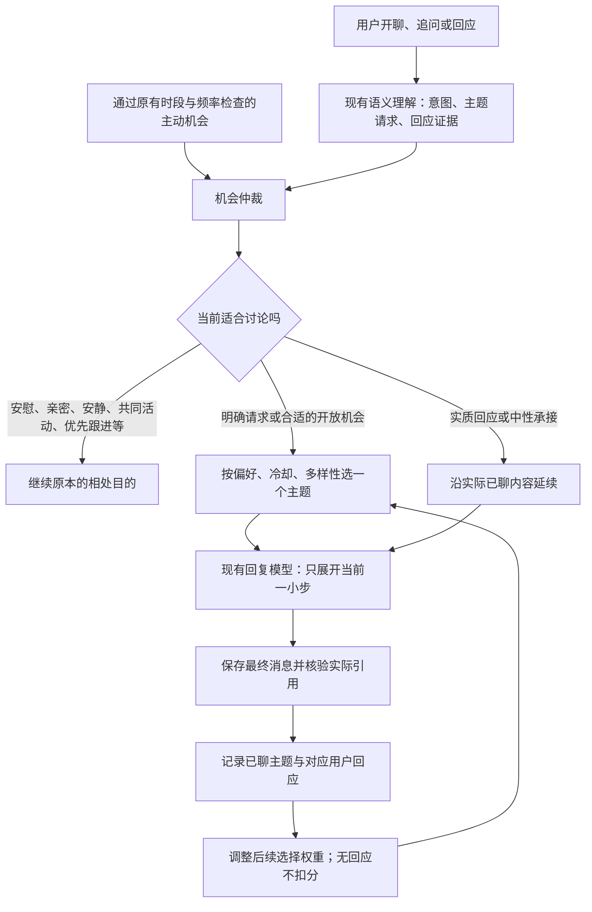

# 有内容可延续的讨论与兴趣反馈

更新于 2026-09-16。对应需求：她除了生活近况，还能自然聊哲学、心理学、历史、地理等内容；根据用户实际回应调整以后选题，不把聊天变成授课或兴趣调查。

## 体验目标与范围

这次为林晓薇（`miyue`）接入 7 类、28 个起始主题，每个主题包含事实底座、至少 3 个可展开角度、公开来源和适用边界。覆盖哲学、心理学、历史、地理、科学、艺术、社会生活。目录提供可以思考的材料，回复仍由模型结合当前对话自由组织，没有固定开场句、逐题轮播或必须问用户的问题。

验收关注四件事：开场有具体内容；追问和不同意见能继续展开；她能根据回应决定聊深一点或停下来；后来选题受真实偏好影响，但仍有新鲜领域。话题数量、字数和发送次数都不能单独代表体验改善。

本轮仅新增讨论材料及反馈机制，不增加主动联系的每日上限或缩短联系间隔。总主动频率继续受原有时段、安静模式、未回复、忙碌及关系约束管理。这里的“多聊/少聊”主要体现为合适机会中的**选题占比**。

## 对话流程



用户明确要求某个领域时可直接选该领域；泛泛“聊点什么”仍尊重已记录的避开偏好。明确请求一个此前屏蔽的领域，允许本轮聊，并不自动抹掉原有长期边界。用户只是提到“哲学课”或发了一句简短确认，不自动打开新话题。当前公开事实、新闻和临床问题继续走原有资料或回应路径。

适合的主动开场有 45% 的讨论材料候选机会，开放分享邀请有 60% 的候选机会；这些是在保护条件通过后的内部选择值，不是每天发送概率，也不是效果指标。有更重要的跟进、约定、有效需要或活动时先处理它们。普通生活分享仍然保留。

## 怎样理解用户回复

| 用户实际表现 | 保存状态 | 后续处理 |
| --- | --- | --- |
| 补充自己的例子、追问、认真反驳 | `engaged` | 继续这一角度，小幅提高该主题及所属领域权重；不同意不等于没兴趣 |
| 明确说以后多聊这个主题/领域 | `wants_more` | 提高相应范围权重；范围必须有原话依据 |
| 明确说少聊 | `less` | 降低对应主题或领域权重 |
| 明确说以后不要主动聊 | `blocked` | 对应范围不再自动选择；明确临时点题仍可聊 |
| 先忙、晚点再看 | `deferred` | 本次收住，不降低兴趣权重 |
| “嗯”“有点意思”等普通承接 | `neutral` | 不加减兴趣，不强制深入；简短确认后仍可继续原题 |
| 换一个话题、转去谈别的事 | `changed_topic` | 结束本次讨论，不等于讨厌整个领域 |
| 无可靠证据、理解失败 | `unknown` | 不修改兴趣权重 |
| 没有回复 | 无用户反馈记录 | 不从沉默推断不喜欢，不催问兴趣 |

“这个话题不想聊，但不是不喜欢心理学”不能降低整个心理学的权重。类别方向性反馈须包含该类别的原话；当类别在前半句、方向在后半句时，仅在受限且一致的当前完整原话中补足证据。记录的是一次回应及其出处，不形成心理诊断、性格标签或“情绪冷淡”的关系判断。

## 选题节奏与防止过度学习

- 默认 7 天内不自动重复同一主题；持续中的追问沿同一主题继续，不重新算作一次开场。
- 有其他类别可选时，避免连续自动开场都落在同一类别。
- 25% 的探索分支在未聊过且未屏蔽的候选中均匀选择，避免只剩用户已知偏好。
- 同一讨论中反复表示感兴趣，不逐句叠加奖励；同一讨论、同一反馈范围使用最近一条方向性证据。
- 数值偏好按 45 天半衰期回到中性附近，并限制上下界；明确禁止不会仅因时间经过自行解除。
- 主题级“少聊”不会直接压低整个领域；明确类别级“多聊”可覆盖更早类别边界。

目录当前是有限的 28 个主题，不是自动扩充的无限知识库。来源用于约束事实，不证明角色亲自读过论文、做过实验或经历过事件。心理学材料不得用于诊断用户；历史争议和科学模型保留适用边界。

## 数据、成本与纠错

`discussion_topic_exposures` 记录一次讨论，`discussion_topic_deliveries` 关联已保存的角色原话，`discussion_topic_responses` 关联用户真实回复及短证据。只有实际保存并通过引用核验的正文才能建立话题记录；准备材料、草稿、失败或取消不算已经聊过。展示层插入空白或换行时，引用可定位回保存文本的原始连续片段；文字、标点或词序变化不能通过核验。

已确认的认真回应、希望多聊或中性承接后，一条普通回复即使漏填材料引用，也可维持同一次讨论；它不会被冒记为新材料投递。初始开场仍必须有实际正文证据，未知反馈、新的主动消息及明确收住会结束旧讨论。

原始开场或反馈被隐藏、删除、更正后，相应证据退出有效偏好计算。反馈与消息在同一事务提交，重试不重复加权。独立剧情和其他角色不向林晓薇的讨论偏好写入记录。

兴趣理解复用已有语义请求，话题正文复用已有回复请求，不新增专门的兴趣分析模型调用。上下文增加一份有界主题材料和必要的输出字段，token 成本仍会增加；“没有新增调用”不等于免费。结构字段遗漏或证据无效时保守跳过记录，不能伪造成功。

启动入口默认启用；设置 `LIFE_DISCUSSION_TOPICS=0` 并重启可关闭新选题及记录路径，保留已有聊天。`/api/health` 返回启用状态，`GET /api/discussion-topics?role=miyue` 提供选题权重、近期讨论和证据，供诊断核对，不把分数展示在角色聊天正文。

## 验证方法与已知限制

自动测试覆盖真实消息依据、换行展示、反驳、中性确认、忙碌、类别边界、冷却、探索、隐藏与删除、重试事务、HTTP 聊天、主动开场与队列。真实模型对照脚本 `scripts/evaluate-discussion-topics.mjs` 使用隔离的合成会话：哲学连续追问；心理学边界后切地理并表达偏好；历史争论后要求少聊；主动提出话题后被反驳、追问和暂缓。基线和新版使用相同模型设置与输入，每个场景独立数据库，无真实聊天输入，也不向用户渠道发送测试消息。

首次试聊确实暴露了可选字段遗漏、跨句换行导致漏记、类别名不在短证据内导致漏记，以及主动响应多带字段被拒绝的问题；修正后再次运行同组场景。保留失败报告，不把回复成功或关键词出现当作机制已经工作。

真实模型样本仍只能证明本次输出，不能证明长期自然度。需要持续留意开场过长、哲学式总结过密、心理学话题滑向分析对方、每轮补问，以及用未发生的生活经历引入材料。系统给出自然表达约束，当前没有把所有风格问题变成可靠的硬性校验。

### 频率效果实验

`scripts/evaluate-discussion-frequency.mjs` 使用隔离内存库、同一目录、同一过往曝光、同一时间及固定随机种子，每组抽样 10,000 次。为了单独观察偏好权重，让目标主题超过 7 天冷却，最后一次讨论属于其他类别。

| 心理学反馈条件 | 心理学被选中的机会占比 |
| --- | ---: |
| 没有方向性反馈 | 14.96% |
| 明确希望多聊心理学 | 20.43% |
| 明确希望少聊心理学 | 8.92% |
| 明确不要主动聊心理学 | 0% |

同一随机种子重复运行结果一致，其他领域仍然保留选择机会。这是受控候选选择实验，不是每日推送比例、真实用户满意度或自然度评分。

### 复现入口

```sh
npm test
npm run check
node scripts/evaluate-discussion-frequency.mjs
node scripts/evaluate-discussion-topics.mjs
# 下列命令才调用配置好的模型；报告名称必须未使用过。
node scripts/evaluate-discussion-topics.mjs --live --label my-discussion-ab
```

合成对话的输入、实际模型请求、最终回复、每轮反馈与用量保存在 `.runtime/discussion-topics/`。报告包含较长上下文，适合本地审阅；不应把整个运行目录作为公开文档提交。

### 本次结果记录

全量自动回归 **1213/1213 通过**，启动文件、服务和前端入口语法检查通过。真实模型先完成 4 组基线/新版对照，共 38 个交互点（含两次主动开场）；随后针对暴露的问题复测。最后一轮中的 2 次供应商连接/空响应失败单独保留，受影响的哲学和历史场景已重新完整跑完；没有将失败试聊算作通过。

| 最终合成场景 | 实际记录与变化 | 体验观察 |
| --- | --- | --- |
| 哲学：观点、追问、中性确认、去忙 | `engaged → engaged → neutral → deferred`；同一次讨论计一次兴趣，忙碌不降权 | 可沿自己的理解继续；中性回应后不要求用户做题 |
| 心理学转地理 | 不想聊一个具体话题落在 topic 范围；随后地理 `wants_more/category`，地理权重 1 → 1.8 | 未把“不是不喜欢心理学”当成拒绝整个领域 |
| 历史：换角度、反驳、要求少聊、求陪伴 | 实质反驳计参与；明确类别 `less` 令历史权重降至 0.49（包含此前 0.14 的参与权重）；之后求陪伴不插历史材料 | 能收住讨论，转向用户当下需求 |
| 主动话题：不同意、要求具体、先忙 | 从主动消息建立讨论；不同意不扣分，追问接续，忙碌为 `deferred` | 有可讨论的观点；部分输出仍偏长、喜欢反问或使用角色化引入，需要继续从真实使用观察 |

初次完整对照中基线共 37 次请求，新版 42 次，差额来自已有质量修复重试；新增兴趣机制本身没有单独的理解模型调用。该次输入 token 合计约 10.29 万和 15.19 万，说明材料、记录协议和重试确有成本，不能宣称此次改动降低了总 token。

保留的主要报告：`final-ab.json`、`naturalness-recheck.json`、`verified-candidate.json`、`network-recheck.json`、`frequency.json`。这些测试支持“内容入口和反馈闭环已接通”，不支持“所有回复都已经自然”。

用户随后指出普通知识问题被固定资料提示截断，已另行修复并验证，见 [普通知识路由修复](KNOWLEDGE-ROUTING-FIX.md)。

服务已重载并通过健康检查，`discussionTopics:true`。重载前 797 条消息均保持不变；生产会话没有注入试聊或测试兴趣记录。
